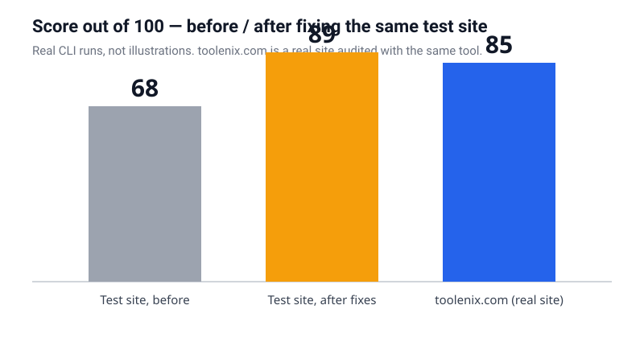

# SEO + GEO Site Audit CLI

[](https://github.com/mrabr381/seo-geo-audit-cli/actions/workflows/ci.yml)
[](#quickstart)
[](#quickstart)
[](LICENSE)


**Find out why Google — and AI answers — ignore your website, then fix it in order.** Crawl a site, score it 0–100 across 33 checks, get a prioritised fix list. No API key, no account, nothing uploaded anywhere.

> **▶ Live demo:** a real audit of [toolenix.com](https://toolenix.com), generated by this CLI — [see the sample report page](https://mrabr381.github.io/seo-geo-audit-cli/sample_output/) (GitHub Pages, no server needed). Or run the web app yourself: `app.py` is Streamlit-ready — 1-click deploy on Streamlit Community Cloud (share.streamlit.io → Create app → repo `mrabr381/seo-geo-audit-cli`, file `app.py` → Deploy).

## A real site, audited

toolenix.com — 20 pages crawled, 2026-11-20:

| Site | Score | Technical | On-page | Links | GEO |
|---|---:|---:|---:|---:|---:|
| **toolenix.com** | **85/100** (B) | 99 | 94 | 71 | 65 |

Top fixes it found: 4 external links flagged (all anti-bot 403s/timeouts, see [limitations](#honest-limitations)) and no HowTo schema. Full report: [`sample_output/report-toolenix.md`](sample_output/report-toolenix.md).

## Before / after



The repo ships a small test site with 6 deliberate flaws (`sample_data/site/`) and the same site fixed (`sample_data/site-fixed/`). Both audited with the CLI — real numbers:

| Site | Score | What was wrong |
|---|---|---|
| Test site, before fixes | **68/100** (C) | Broken internal + external links, 2 H1s on one page, missing title, missing meta description, images without alt |
| Test site, after fixes | **89/100** (B) | Only HTTPS missing (a local `http://` test site) and a few thin pages |

Full reports: [`sample_output/report.md`](sample_output/report.md) and [`sample_output/report-fixed.md`](sample_output/report-fixed.md).

## Quickstart

```bash
git clone https://github.com/mrabr381/seo-geo-audit-cli.git
cd seo-geo-audit-cli
python -m venv .venv && source .venv/bin/activate
pip install -r requirements.txt

# Audit any site (50 pages max by default)
python -m seo_audit --url https://example.com --out report/

# Fully offline except the site itself (skips external-link checks)
python -m seo_audit --url https://example.com --no-external --out report/
```

Exit codes: `0` = audit completed, `1` = audit failed (start page unreachable), `2` = usage error. Try it offline on the bundled test site: serve `sample_data/site` on port 8123 and audit `http://127.0.0.1:8123/` — or run `scripts/run_sample_audit.sh`, which does both.

## What it checks

33 checks in 4 categories, all computed from a live crawl — nothing hardcoded. Scoring is weighted: a broken internal link costs 8 points, a missing `llms.txt` costs 5, a missing meta description costs 4. Fixes are listed highest-impact first.

| Category | Checks include |
|---|---|
| **Technical** (10) | HTTPS, robots.txt, sitemap.xml (+ whether its URLs resolve), canonical, viewport, charset, `lang`, page size ≤ 200 KB, render-blocking resources |
| **On-page SEO** (12) | Title (present, 30–60 chars, unique), meta description, exactly one H1, heading hierarchy, Open Graph tags + image, image alt coverage, content length, internal links |
| **GEO** (8) | `llms.txt`, FAQPage + HowTo schema, JSON-LD, question-style headings, dates, figures/facts, lists and tables |
| **Links** (3) | No broken internal links, no broken external links, every page linked in |

Each run writes `report.md`, `report.html` (self-contained) and `index.html` (a Pages-ready showcase page) into the output folder.

## Comparison

| | seo-geo-audit-cli | Semrush | Ahrefs |
|---|---|---|---|
| Price | **Free** | $139/mo | $129/mo (Lite) |
| GEO / AI-search checks | Yes | Partial ($99/domain/mo add-on) | No |
| API key / account | None | Required | Required |
| Data leaves your machine | Never | Yes | Yes |

Prices are the vendors' published list prices as verified in November 2026 research.

## Honest limitations

- **No real PageSpeed / CrUX data** — speed is judged from page size and render-blocking resources only.
- **No JavaScript rendering** — content that only appears after JS runs is invisible.
- **Anti-bot sites get flagged as broken links** — LinkedIn, Medium, Etsy answer HEAD requests with 403s/timeouts. Verify those by hand.
- **robots.txt is respected** — blocked pages are reported as failed-to-load, not audited.
- **Local `http://` sites fail the HTTPS check** — correct behaviour; the bundled test site scores 89 instead of 100 for exactly this reason.

## Tests

```bash
pip install pytest
python -m pytest   # scoring maths: 68/89/85 reports, grade boundaries, weighted totals
```

CI runs pytest on every push (see the badge at the top).

## Project layout

```
├── app.py                  # Streamlit web app (repo root, deploy-ready)
├── seo_audit/              # cli.py, crawler.py, checks.py (33 checks), report.py
├── sample_data/site[-fixed]/  # flawed test site + fixed version (68 → 89)
├── sample_output/          # real reports + index.html demo page
└── scripts/run_sample_audit.sh
```

MIT — see [LICENSE](LICENSE).
